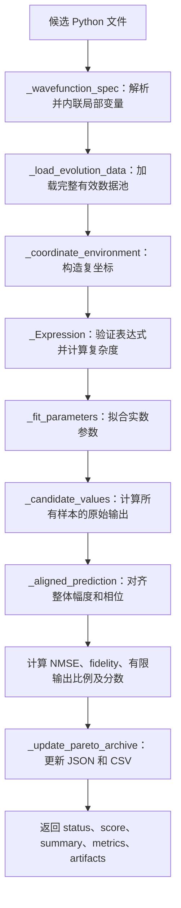

# eval_program.py 中文说明

本文对应同目录下的 [eval_program.py](eval_program.py)，解释它的整体流程、数学指标、输入输出，以及全部 31 个函数和方法（包括类方法和嵌套函数）。以下说明以当前代码的实际行为为准。

## 1. 这个程序解决什么问题

这是双电子 FQH（分数量子霍尔）符号回归任务的**候选公式评估器**。演化程序提出一个复数波函数表达式，评估器根据数据调整表达式中的实数参数，衡量它与数据集目标波函数的接近程度，并保存精度与复杂度之间的 Pareto 前沿。

它的主要输入是一个候选 Python 文件的路径；主要入口是 `evaluate(program_path)`。它返回包含状态、分数、指标和评估产物的字典，并尝试更新 JSON、CSV 档案。

有三个理解程序的关键点：

- **拟合与评分使用同一个完整数据池**：只剔除被掩码排除或包含非有限数值的样本，没有训练、验证、测试集划分。因此分数表示对当前数据的拟合程度，不能直接解释为独立测试集上的泛化表现。
- **精度和复杂度分开处理**：LoongFlow 接收到的标量分数是 `fidelity × finite_fraction`。复杂度用于 Pareto 筛选，不作为分数的乘法惩罚，但表达式仍受到长度和 AST 节点上限约束。
- **不检查交换反对称性或角动量结构**：评估器没有对应指标或评分项；这些性质需要由候选公式的构造保证。

## 2. 总体执行流程



整个过程中，评估器**不导入或执行候选 Python 文件**。它用 AST（抽象语法树）读取文件结构，再用自建解释器计算白名单内的数学表达式。候选文件中的 `import numpy as np` 是接口格式要求，真正用于计算的 NumPy 来自评估器自身。

## 3. 输入格式和配置

### 3.1 候选程序格式

下面是符合接口的示例：

```python
import numpy as np

def wavefunction(z1, z2, alpha=0.5):
    difference = z1 - z2
    radius_sq = np.abs(z1) ** 2 + np.abs(z2) ** 2
    return difference * np.exp(-alpha * radius_sq)
```

格式限制如下：

| 项目 | 实际要求 |
| --- | --- |
| 文件顶层 | 可选模块文档字符串，然后只包含 `import numpy as np` 和一个函数定义；普通注释不影响 AST |
| 函数 | 名称必须是 `wavefunction`，不能有装饰器，可有函数文档字符串 |
| 参数 | 前两个必须为 `z1, z2`；其余是最多 15 个实数拟合参数，每个必须有有限数值默认值 |
| 参数类型 | 不允许仅限位置参数、仅限关键字参数、`*args`、`**kwargs`；默认值不接受布尔值或复数 |
| 函数体 | 最后必须有一个带表达式的 `return`；之前只允许 `name = expression` 形式的简单局部赋值 |
| 局部赋值 | 一个名称只能赋值一次；不能覆盖坐标、参数、`abs`、`np`；可以引用之前已定义的局部变量 |
| 运算 | `+`、`-`、`*`、`/`、`**`，以及一元正负号 |
| 函数调用 | `abs(...)`，或白名单中的单参数 `np` 函数；不接受关键字参数 |
| 白名单函数 | `np.exp`、`np.sqrt`、`np.abs`、`np.conj`、`np.conjugate`、`np.real`、`np.imag`、`np.log`、`np.sin`、`np.cos`、`np.tanh` |
| 表达式字面量 | 绝对值不超过 12 的整数、`1j`、`np.pi`；可用 `1 / 2` 表示结构比例 |
| 连续常数 | 表达式中不能直接写 `0.5` 等浮点字面量；应写成参数，并在函数签名中给出默认值 |
| 输出 | 一个标量，或形状为 `(n,)` 的向量；标量会广播到全部样本 |

例如 `return 0.5 * (z1 - z2)` 会被拒绝，而把 `0.5` 放在 `alpha=0.5` 中，再在表达式里使用 `alpha`，则符合常数规则。

不允许循环、条件分支、索引、列表、任意属性访问和任意函数调用。最终展开后的表达式最多 2000 个字符，解析出的 Python AST 最多 220 个节点。

**辅助变量的实际可用范围**：`_coordinate_environment()` 会生成 `x1`、`z12`、`Z_cm` 等名称，但 `evaluate()` 为候选表达式设置的允许变量只有 `z1`、`z2` 和参数名称。因此候选不能直接使用 `z12` 或 `r1_sq`，可以像示例一样通过局部赋值自行定义和展开；直接写 `z1 - z2`、`np.abs(z1) ** 2` 也可以。裸写 `pi`、`I` 不被允许，使用 `np.pi`、`1j`。

### 3.2 数据集格式

评估器读取 `.npz` 文件，使用 `np.load(..., allow_pickle=False)`。

| 字段 | 形状 | 作用 |
| --- | --- | --- |
| `features` | `(n, 4)` | 必需；列顺序必须为 `x1, y1, x2, y2` |
| `psi_scaled` | `(n,)` | 复数目标波函数；存在时优先使用 |
| `psi_real`、`psi_imag` | 各为 `(n,)` | 缺少 `psi_scaled` 时，用两者组装复数目标 |
| `finite_mask` | `(n,)` | 可选；转成布尔掩码，缺省时全部为真 |

最终保留的样本必须同时满足掩码为真、全部坐标有限、目标实部和虚部有限。这里的“有限”指不是 `NaN`、正无穷或负无穷。没有有效样本时评估失败。

### 3.3 常量与环境变量

| 常量或环境变量 | 默认值 | 含义 |
| --- | --- | --- |
| `N_ELECTRONS` | `2` | 电子数；当前接口和坐标约定针对双电子 |
| `MAX_PARAMETERS` | `15` | 拟合参数数量上限 |
| `MAX_EXPRESSION_LENGTH` | `2000` | 展开后的表达式字符串长度上限 |
| `MAX_AST_NODES` | `220` | Python AST 节点上限，不等于评分记录中的符号复杂度 |
| `MAX_STRUCTURAL_INTEGER` | `12` | 结构整数的绝对值上限 |
| `LOONGFLOW_SR_MAX_NFEV` | `120` | 每轮 `least_squares` 的 `max_nfev` |
| `LOONGFLOW_SR_MAX_BOUND_EXPANSIONS` | `3` | 参数边界最多扩展次数，实际使用值至少为 0 |
| `LOONGFLOW_SR_BOUND_EXPANSION_FACTOR` | `5.0` | 边界扩展倍数，实际使用值至少为 1.1 |
| `LOONGFLOW_SR_BOUND_HIT_FRACTION` | `0.98` | 参数绝对值达到边界跨度的这一比例时视为触边；实际值截在 `[0.5, 1.0]` |
| `LOONGFLOW_SR_MAX_PARAMETER_SPAN` | `10000.0` | 每个参数正负边界的最大跨度，实际使用值至少为 20 |
| `LOONGFLOW_SR_DATASET` | 未设置 | 数据路径，优先级最高 |
| `FQH_SYMBOLIC_DATASET` | 未设置 | 数据路径的兼容配置，优先级次之 |
| `LOONGFLOW_SR_PARETO_ARCHIVE` | `./output-fqh-symbolic-regression-full-data/pareto_archive.json` | JSON 档案路径 |
| `LOONGFLOW_SR_PARETO_CSV` | JSON 路径更换为 `.csv` 后缀 | CSV 输出路径，可独立指定 |

默认数据路径依次查找仓库根目录和仓库父目录下的 `datasets/disk_n2_Q6_kapa_100/dataset_uniform.npz`，选择第一个存在的文件；都不存在时保留仓库根目录下的路径，实际加载时再报错。

参数优化相关环境变量在模块导入时读取；三个路径查询函数在调用时读取配置。相对路径根据进程当前工作目录解释。`_EPS` 为 `float64` 的最小正规正数 `tiny`，约为 `2.225 × 10^-308`，用于防止零分母；它不是常见的机器精度 `eps`。Pareto 精度比较容差为 `PARETO_ACCURACY_EPSILON = 1e-12`。

## 4. 每个函数和方法的功能

### 4.1 候选解析和局部变量展开

`CandidateValidationError` 继承 `ValueError`，用于表示候选接口或表达式不合法。这个异常类没有自定义方法。

#### 1. `_LocalExpressionInliner.__init__(bindings)`

保存“局部变量名称 → 已展开 AST 表达式”的字典。它是 `ast.NodeTransformer` 子类的构造方法，为后续变量替换提供查找表，不进行数值运算。

#### 2. `_LocalExpressionInliner.visit_Name(node)`

访问 AST 中的名称节点。如果名称是读取上下文，并且存在于 `bindings` 中，就用相应表达式的深拷贝替换它，并复制源码位置；其他节点原样返回。深拷贝使不同位置的展开不会共享同一个可变 AST 子树。

例如，先有 `difference = z1 - z2`，则后续读取 `difference` 会被替换为 `z1 - z2`。

#### 3. `_inline_local_assignments(body, protected_names)`

接收去掉函数文档字符串后的语句列表和不能覆盖的名称集合，返回最终 `return` 表达式的展开版 AST。

它检查函数以非空 `return` 结束，然后按顺序处理此前的简单赋值：检查目标是否合法，用此前的绑定展开右侧表达式，通过 `_Expression` 验证该表达式，再保存绑定。最后展开返回值。

即使某个局部赋值没有被 `return` 使用，它也会被验证，所以不能借助无用赋值加入白名单之外的操作。局部变量不能向前引用。验证后最终未使用的局部赋值不进入最终表达式的复杂度。

#### 4. `_dataset_path()`

返回当前数据路径 `Path`。优先读取 `LOONGFLOW_SR_DATASET`，再读取 `FQH_SYMBOLIC_DATASET`，最后采用 `DEFAULT_DATASET`。配置路径支持 `~` 展开；该函数不检查文件是否存在。

#### 5. `_pareto_archive_path()`

返回 JSON 档案路径 `Path`。优先使用 `LOONGFLOW_SR_PARETO_ARCHIVE`，否则使用默认路径；配置路径支持 `~` 展开。

#### 6. `_pareto_csv_path()`

返回 CSV 路径 `Path`。优先使用 `LOONGFLOW_SR_PARETO_CSV`，否则把当前 JSON 档案路径的后缀替换为 `.csv`。

#### 7. `_wavefunction_spec(program_path)`

读取候选源文件并生成表达式规格，是候选接口的第一道检查。

它检查文件存在、UTF-8 读取和 AST 解析是否成功，验证顶层结构、函数名称及参数格式，用 `ast.literal_eval()` 解析参数默认值，再调用 `_inline_local_assignments()` 展开函数体。最后通过 `ast.unparse()` 生成规范化表达式字符串，检查 2000 字符上限。

返回结构为：

```python
{
    "expression": "展开后的返回表达式",
    "coordinates": ["z1", "z2"],
    "parameters": {"alpha": 0.5},
}
```

参数保持签名中的顺序。非数值、布尔、复数或非有限默认值会触发 `CandidateValidationError`。保留参数名称的进一步检查在 `evaluate()` 中完成。

### 4.2 坐标构造和表达式解释器

#### 8. `_coordinate_environment(coordinates)`

把形状为 `(n, 4)` 的实数坐标转为向量化表达式计算所需的字典。每个坐标变量通常是长度为 `n` 的数组。

代码使用的复坐标约定是 **`z_i = x_i - 1j * y_i`**。注意这里虚部带负号。

| 生成的名称 | 含义 |
| --- | --- |
| `x1, y1, x2, y2` | 两个电子的实坐标 |
| `z1, z2` | 对应复坐标 |
| `z1_bar/z1_conj`、`z2_bar/z2_conj` | 复坐标共轭，两种名称互为别名 |
| `r1_sq, r2_sq` | 各电子到原点的距离平方 `x_i² + y_i²` |
| `r1, r2` | 距离 |
| `Z_cm` | 质心复坐标 `(z1 + z2) / 2` |
| `Z_cm_bar, Z_cm_conj` | 质心复坐标的共轭 |
| `r_cm_sq/R_cm_sq`、`r_cm/R_cm` | 质心到原点的距离平方和距离，两种大小写互为别名 |
| `z12`、`z12_bar/z12_conj` | 相对复坐标 `z1 - z2` 及其共轭 |
| `r12_sq, r12` | 两电子距离平方和距离 |
| `dot12` | `x1*x2 + y1*y2` |
| `cross12` | `x1*y2 - y1*x2` |
| `I`、`pi/PI` | 常量 `1j` 和圆周率 |

输入形状不正确时抛出 `RuntimeError`。这些内部名称也用于识别不可用作拟合参数的保留名称；其生成不代表候选可以直接引用它们，允许范围见第 3.1 节。

#### 9. `_Expression.__init__(source, allowed_names)`

将表达式字符串以 `mode="eval"` 解析成 AST，并构造严格白名单解释器。

它先检查 AST 总节点数不超过 220，再逐个检查运算符、调用形式、变量名称、NumPy 属性和字面量。索引、比较、推导式等未列入白名单的节点都会被拒绝。验证通过后，保存 AST 到 `self.tree`，并用 `_tree_complexity()` 计算 `self.complexity`。

#### 10. `_Expression._validate_literal(value)`

验证表达式中的常量。允许绝对值不超过 12 的整数以及恰好等于 `1j` 的复数字面量；禁止布尔值、浮点字面量和其他类型。

负号在 AST 中是独立的一元运算，因此 `-1j` 可由“负号 + `1j`”表示。`np.pi` 的许可由属性检查负责，不走浮点字面量规则。该方法只针对表达式，不影响签名中的小数参数默认值。

#### 11. `_Expression._tree_complexity(node)`

递归计算符号表达式树复杂度并返回整数：

- 每个变量出现、参数出现、字面量或 `np.pi`：计 1。
- 一元运算：计 `1 + 子表达式复杂度`。
- 二元运算：计 `1 + 左子树复杂度 + 右子树复杂度`。
- 数学函数调用：计 `1 + 参数表达式复杂度`。

`np.<函数>` 的 Python 属性包装不额外计数。例如 `z1 - z2` 的复杂度为 3，`np.abs(z1 - z2)` 为 4。

局部变量先被内联，因此不会减少重复出现的子树：`d = z1 - z2; return d * d` 展开为 `(z1 - z2) * (z1 - z2)`，复杂度为 7。参数数量和参数出现次数是不同概念；复杂度按出现次数计数。

#### 12. `_Expression._function_name(node)`

识别合法调用目标：裸名称 `abs` 返回 `"abs"`，`np.<白名单函数>` 返回相应函数名，其他形式返回 `None`。它用于语法验证和实际求值时的函数选择。

#### 13. `_Expression.evaluate(environment)`

接收“名称 → 数值或数组”的环境字典，调用 `_evaluate_node()` 返回表达式结果。在 `np.errstate(all="ignore")` 中运行以忽略 NumPy 数值警告；忽略警告不会把 `NaN` 或无穷变成有效输出，后续仍会检查它们。

#### 14. `_Expression._evaluate_node(node, environment)`

表达式解释器的递归求值核心：常量返回值，变量从环境读取，一元和二元运算先计算子节点，`np.pi` 返回 `math.pi`，函数调用从 `_FUNCTIONS` 查找实际 NumPy 函数。

返回值可以是标量或数组。这里不使用 Python 的 `eval()` 或 `exec()`，也不会调用候选文件中定义的 Python 函数。

### 4.3 输出转换、全局对齐和误差指标

#### 15. `_parameter_values(names, vector)`

把按参数顺序排列的数值向量转成 `{参数名: Python float}` 字典。`zip(..., strict=True)` 要求名称和向量长度一致，长度不一致会报错。

#### 16. `_as_complex_vector(value, size)`

统一候选输出的形状和类型，返回长度为 `size` 的 `complex128` 数组。标量广播到所有样本；形状正好为 `(size,)` 的向量进行类型转换；其他形状被拒绝。

该函数负责形状和类型，不负责有限性检查，因此包含 `NaN` 或无穷的数值向量仍可能进入后续对齐和评分。

#### 17. `_candidate_values(expression, coordinate_environment, parameter_names, vector)`

复制坐标环境，用 `_parameter_values()` 注入当前参数值，调用表达式解释器，再用 `_as_complex_vector()` 规范输出。样本数量从环境中的 `x1` 数组长度取得。

这个函数是“给定一组参数，计算所有样本上的候选波函数”的统一接口，优化时会反复调用，最终评分时也会调用。

#### 18. `_aligned_prediction(raw, target)`

求一个最佳全局复系数，以消除候选与目标之间整体幅度、整体相位的差异。返回 `(prediction, global_scale)`，有效位置上满足 `prediction = global_scale * raw`。

设有限输出位置组成集合 `F`，原始预测为 `r`，目标为 `t`。理想的最小二乘复系数为：

```text
c = Σ(i∈F) conj(r_i) * t_i / Σ(i∈F) |r_i|²
```

为降低直接对大数平方造成的溢出，代码先计算 `s = max(|r_i|)`，令 `u = r / s`，求 `a = <u,t> / <u,u>`，再返回 `c = a / s`。其中 `<u,t>` 使用 `np.vdot`，会对第一个向量取共轭。

非有限输出位置的预测被设为零。若全部输出非有限、原始幅度过小，或归一化分母无效，则返回全零预测和 `0j`。全局复系数独立解析求解，不占用 15 个实数拟合参数名额。

#### 19. `_normalized_mse(prediction, target)`

计算归一化均方误差 NMSE：

```text
NMSE = Σ |prediction_i - target_i|² / Σ |target_i|²
```

越小越好。由于分子和分母都对应同一批样本，是否分别除以样本数不改变比值。目标范数过小或结果非有限时返回正无穷。NMSE 是诊断指标，不直接构成标量分数。

#### 20. `_fidelity(prediction, target)`

计算复向量的归一化重叠平方：

```text
fidelity = |Σ conj(prediction_i) * target_i|²
           / (Σ |prediction_i|² * Σ |target_i|²)
```

越接近 1，两个向量的方向越一致。分母过小或非有限时返回 0；正常结果截在 `[0, 1]`。它对非零整体复系数不敏感，因此整体幅度和相位不会影响这一指标。

### 4.4 参数拟合与数据加载

#### 21. `_fit_parameters(expression, train_environment, train_target, parameter_names, initial)`

调用 SciPy 的 `least_squares()` 优化实数参数，返回 `(最佳参数向量, 优化信息字典)`。参数名中的 `train` 是历史命名，这里实际传入的是完整有效数据池。

若没有拟合参数，直接返回初始空向量，并记录 `attempted=False`、`success=True`、`nfev=0`。

有参数时，先计算目标波函数幅度的 RMS，建立嵌套残差函数，并记录初始参数的残差平方和。每个参数使用以零为中心的对称边界：

```text
initial_span_j = max(20, 10 * |initial_j| + 10)
maximum_span   = max(20, MAX_PARAMETER_SPAN)
span_j         = min(initial_span_j, maximum_span)
bounds_j       = [-span_j, +span_j]
```

每轮优化使用 `ftol=xtol=gtol=1e-7`，`x_scale=max(|start|, 1)`，并配置每轮 `max_nfev`。每得到一个有限且残差平方和不大于历史最佳的结果，就更新最佳参数。

若结果的某个参数满足 `|parameter_j| >= hit_fraction * span_j`，且跨度还未达到上限，就仅扩大这些参数的边界，再从上一轮结果附近继续优化。默认最多扩展 3 次，即最多运行 4 轮；这不是随机多起点搜索。

优化信息包括是否尝试、是否至少一轮报告成功、累计 `nfev`、消息、最佳残差平方和、边界扩展次数、最后一轮触边参数、初始/最终跨度和各轮记录。`nfev` 累加的是 SciPy 报告的次数，不能简单当作所有内部计算的总次数。

优化异常被内部捕获，函数仍返回当前保留的最佳向量；如果之前没有改进，它就是初始值。异常信息中的文字写着“used initialization”，但发生在后续轮次的异常不必然抹去已找到的更好结果。`success=True` 也不等于数学意义上的全局最优。

#### 22. `_fit_parameters.<locals>.residual(vector)`

这是 `_fit_parameters()` 内部定义的函数，作为回调传给 `least_squares()`。它输入当前实数参数向量，返回长度为 `2*n` 的实数残差数组。

每次计算候选输出并重新求最佳全局复系数，然后计算与目标的差。对于候选原始输出非有限的位置，把差值替换为 `10 * target_rms * (1 + 1j)`。所有差值除以目标 RMS 后，拼接实部和虚部：

```text
residual = [全部样本的实部残差, 全部样本的虚部残差]
```

这样，实数优化器可以优化复数误差。候选验证错误、算术错误或浮点错误会转成长度为 `2*n`、每项为 10 的惩罚残差。这里优化的是对齐后的残差平方和；最终分数另由 fidelity 和有限输出比例计算。

#### 23. `_load_evolution_data(path)`

读取数据集、检查字段和形状、过滤无效样本，返回：

```python
{"coordinates": 有效坐标数组, "target": 有效复数目标数组}
```

结果存入模块级 `_DATA_CACHE`，键是数据文件的绝对解析路径。同一进程重复评估同一路径时复用数据，减少磁盘读取。

文件不存在、缺少字段、形状不匹配、没有有效样本时抛出对应异常。缓存仅根据路径识别文件；在同一进程中覆盖同一路径的文件内容，不会自动刷新缓存。

### 4.5 Pareto 档案和 CSV 导出

#### 24. `_archive_lock(archive_path)`

用 `@contextmanager` 提供文件锁上下文，供多个评估子进程串行更新同一 JSON 档案。

锁文件是档案路径追加 `.lock`，例如 `pareto_archive.json.lock`。函数通过 `os.O_CREAT | os.O_EXCL` 排他创建锁，成功后写入当前进程 PID；锁已存在时每 0.05 秒重试，等待超过 10 秒就抛出 `TimeoutError`。超过 120 秒的锁被视为过期并删除。

进入 `with` 时持锁，退出时关闭文件描述符并删除锁文件。它还会提前创建档案所在目录。

#### 25. `_candidate_identifier(expression, parameter_names)`

把展开后的表达式和有序参数名称列表序列化为固定格式 JSON，计算 SHA-256，并取前 20 个十六进制字符作为候选 ID。

ID 不包含拟合值、参数默认值、分数或数据路径。因此同一表达式和参数列表，即使使用不同初值或得到不同拟合结果，也会拥有相同 ID。它也不会做代数化简来识别数学上等价但写法不同的公式。

#### 26. `_pareto_front(champions)`

输入每个整数复杂度档位的最佳候选列表，返回未被支配的候选列表，目标为“复杂度越小越好，精度越大越好”。

先按复杂度升序排序，再扫描候选：只有当前精度比此前保留的最佳精度高出 `1e-12`，才进入前沿。对于预期输入，较复杂但精度没有明显提高的公式会被排除。

例如 `(复杂度, 精度)` 为 `(3, 0.90)`、`(7, 0.89)`、`(10, 0.95)` 时，前沿只保留第一和第三个。该函数依赖上游已经为每个复杂度保留唯一冠军。

#### 27. `_front_selections(front)`

在前沿中选择三种代表公式，返回它们的 ID；空前沿返回 `{}`，选择过程不删除前沿中的其他公式。

| 返回字段 | 选择方式 |
| --- | --- |
| `max_accuracy_id` | 精度最高的前沿公式 |
| `knee_id` | 前沿至少有 3 点且两个目标都有跨度时，分别把复杂度和精度归一化，选取离首尾连线垂直距离最大的点；其他情况采用最高精度公式 |
| `pysr_score_id` | 使用相邻前沿点的对数损失改善斜率，并在损失不超过最小损失 1.5 倍的候选中选择斜率最大者；没有符合条件的候选时采用最高精度公式 |

这里的 PySR 风格损失和斜率定义为：

```text
loss_i  = max(1 - accuracy_i, _EPS)
slope_i = log(loss_(i-1) / loss_i) / (complexity_i - complexity_(i-1))
```

斜率衡量每增加一个复杂度单位换来的对数损失改善。代码自行实现这种选择规则，没有调用 PySR 或 SymbolicRegression.jl。

#### 28. `_write_pareto_csv(csv_path, front, selections)`

把当前完整 Pareto 前沿写入 CSV，一行对应一个公式；不导出所有评估历史，也不导出已经被支配的复杂度冠军。

字段由 `_PARETO_CSV_FIELDS` 决定，包括 `candidate_id`、`original_expression`、`score`、`fidelity`、`accuracy`、`loss`、`nmse`、`finite_fraction`、`complexity`、`parameter_count`、`fitted_parameters`、全局复系数实部/虚部、`pysr_score`、`selection` 和 Unix 评估时间。

CSV 中 `score=accuracy`，`loss=max(1-accuracy, 0)`；`pysr_score` 是上一节的相邻点斜率，首个前沿点没有前驱，所以该字段为空。它不是 LoongFlow 标量分数。同一公式可能有多个选择标签，用 `|` 连接；拟合参数作为 JSON 字符串写入单元格。

`original_expression` 实际来自 AST 展开、重新生成后的表达式，不是候选文件未经处理的原始文本。函数先写带 PID 的临时文件，再用 `os.replace()` 替换目标文件，并在 `finally` 中清理 CSV 临时文件。

#### 29. `_update_pareto_archive(candidate, dataset_path)`

负责持久化档案的完整更新，输入当前候选记录和数据路径，返回档案状态摘要。

它在 `_archive_lock()` 内读取旧 JSON；读取失败时从空档案开始。旧档案的 `schema_version` 不是 1，或者记录的数据绝对路径与本次不同，也会重建档案。

`complexity_champions` 用复杂度整数的字符串作为键。某档位没有冠军，或当前精度高出旧冠军超过 `1e-12`，才替换冠军；同精度时保留旧记录。随后重算前沿和代表选择，更新时间戳，通过临时文件替换 JSON，并写入 CSV。

JSON 的主要结构为：

```text
schema_version        档案格式版本，当前为 1
dataset               数据集绝对路径
objectives            精度最大化、复杂度最小化的说明
complexity_champions  每个复杂度的最佳候选，包括已被支配的冠军
pareto_front          当前未被支配的候选记录
selections            三种代表选择的 ID
updated_at_unix       最近更新时间
```

返回摘要包含路径、是否刷新复杂度冠军、是否属于前沿、前沿大小、当前档位最佳精度、代表选择，以及只含 ID/复杂度/精度/表达式的简化前沿。

有两个实现细节影响结果解释：数据集身份仅按路径判断，不按内容哈希判断；`on_pareto_front` 按候选 ID 判断，如果同一公式的历史更优拟合记录已经在前沿，新评估也可能返回真。JSON 和 CSV 分别替换，不构成一个跨文件原子事务，CSV 失败时 JSON 可能已经更新。

### 4.6 评估入口和失败结果

#### 30. `_failure(status, summary, start_time, error_type)`

统一构造失败返回值。保留传入状态、说明和错误类型，设置 `score=0.0`、`metrics.validity=0.0`，用 `time.perf_counter()` 计算评估耗时，并在 `artifacts` 中写入 `error_type` 和 `reason`。

它只封装结果，不重新抛异常。

#### 31. `evaluate(program_path)`

对外入口，串联前面所有组件，返回评估字典。该函数是同步函数，不是 `async` 函数。

主要步骤如下：

1. 记录开始时间，解析候选规格，加载有效数据。
2. 构建坐标环境，并检查拟合参数名不能与内部坐标/常量名、白名单函数名或 `np` 冲突。
3. 用坐标名称 `z1,z2` 和拟合参数名称建立表达式解释器，从签名默认值建立初始参数向量。
4. 拟合参数，计算原始输出，求最佳全局复系数。
5. 计算有限输出比例、全数据 NMSE、全数据 fidelity 和精度。
6. 生成候选 ID 和档案记录，尝试更新 JSON、CSV。
7. 返回成功结果；捕获候选验证错误返回 `validation_failed`，捕获其他异常返回 `execution_failed`。

档案更新的 `OSError`、`TimeoutError`、`ValueError` 被单独处理：仍返回已完成的科学评估和分数，把问题写入 `artifacts.pareto.archive_error`。此时前沿状态使用默认值，并不表示公式本身无效。其他未被这层捕获的档案异常仍会进入外层失败处理。

## 5. 如何理解分数和返回字段

### 5.1 分数公式

```text
finite_fraction = 候选原始输出中实部和虚部均有限的样本数 / 有效数据池样本数
accuracy        = clip(full_data_fidelity * finite_fraction, 0, 1)
score           = accuracy
```

数据过滤决定哪些样本进入评估；`finite_fraction` 则衡量公式在进入评估的样本上有多少输出有效。这是两个不同阶段的检查。

例如，对齐后的 fidelity 为 0.98，有限输出比例为 0.90，则分数为 0.882。公式复杂度为 10 或 30 都不会改变这个乘法，但会影响 Pareto 档案中的地位。非有限输出位置在对齐预测中置零，影响重叠；有限输出比例还会进一步降低最终分数。

### 5.2 顶层字段

| 字段 | 含义 |
| --- | --- |
| `status` | `success`、`validation_failed` 或 `execution_failed` |
| `score` | 提供给 LoongFlow 的单一数值分数 |
| `summary` | 可读摘要，成功时包括精度、fidelity、NMSE、有限比例、复杂度、前沿状态和拟合参数 |
| `metrics` | 数值和布尔指标，适合日志或自动比较 |
| `artifacts` | 表达式、参数、优化信息、档案信息等较详细的结果 |

`status="success"` 表示完成了评估，不表示高分，也不要求优化器报告收敛；合法但预测为零的表达式可以成功返回零分。

### 5.3 成功时的 `metrics`

| 字段 | 含义 |
| --- | --- |
| `validity` | 成功评估时为 1.0 |
| `full_data_nmse` | 完整有效数据池上的对齐预测 NMSE |
| `full_data_fidelity` | 完整有效数据池上的归一化复重叠平方 |
| `finite_fraction` | 候选原始输出有限的比例 |
| `expression_complexity` | 符号表达式树复杂度 |
| `parameter_count` | 签名中拟合参数的数量 |
| `accuracy` | 与 `score` 相同 |
| `pareto_front_member` | 档案返回的前沿成员状态 |
| `pareto_bin_improved` | 是否刷新当前复杂度档位冠军 |
| `pareto_front_size` | 当前前沿候选数量 |
| `optimizer_boundary_expansions` | 优化时边界扩展次数 |
| `optimizer_boundary_hit` | 最后一轮结果是否仍有触边参数 |
| `eval_time` | 从入口开始到返回前记录的耗时，单位为秒 |

### 5.4 成功时的 `artifacts`

| 字段 | 含义 |
| --- | --- |
| `candidate_id` | 表达式和参数名称列表对应的短哈希 |
| `expression` | 展开后的表达式字符串 |
| `fitted_parameters` | 最终采用的实数参数值 |
| `global_scale` | 最佳全局复系数，保存为 `real`、`imag` |
| `optimizer` | 优化状态、残差代价和边界调整记录 |
| `pareto` | 档案路径、前沿摘要、代表选择，失败时可能含 `archive_error` |
| `evaluation_mode` | 固定为 `full_data_accuracy_complexity_pareto` |
| `samples_used` | 数据过滤后实际使用的样本数 |
| `dataset` | 本次配置的数据路径字符串 |

拟合参数和全局复系数通过这些字段返回；评估器不会把它们自动写回候选源文件。

## 6. 从简单公式看一次评估

考虑同目录 `initial_program.py` 中的公式：

```python
import numpy as np

def wavefunction(z1, z2):
    return z1 - z2
```

解析结果的参数字典为空，表达式复杂度为 3。对每个样本，评估器构造 `z1=x1-1j*y1`、`z2=x2-1j*y2`，直接计算两者之差，不运行数值参数优化，但仍拟合全局复系数。

如果所有坐标和计算结果都有限，且目标在全部样本上恰好是这一公式乘以一个非零固定复系数，那么全局对齐后 NMSE 接近 0、fidelity 接近 1、有限输出比例为 1，最终分数接近 1。这一结论针对这个假设数据，真实数据的得分仍需要实际评估。

从仓库根目录启动整个演化任务时，使用项目包装脚本：

```bash
export LOONGFLOW_SR_DATASET="/absolute/path/to/dataset_uniform.npz"
./run_math.sh modified_symbolic_regression --background
```

Python 集成时调用 `evaluate(候选文件路径)` 即可。文件末尾的 `if __name__ == "__main__"` 不是额外函数：它检查命令行必须有一个候选路径参数，否则显示用法；有参数时调用 `evaluate()`，把结果格式化为 JSON 打印。正常任务运行遵循项目的 shell 包装脚本约定。

## 7. 阅读源码的建议顺序

先看 `evaluate()` 把握输入输出，再看 `_wavefunction_spec()` 和 `_Expression` 理解候选规则，随后阅读 `_fit_parameters()`、`_aligned_prediction()`、两个误差指标，最后阅读 Pareto 档案相关函数。这样可以把“公式是否合法”“参数如何拟合”“得分如何产生”“公式如何入档”四个环节对应起来。
